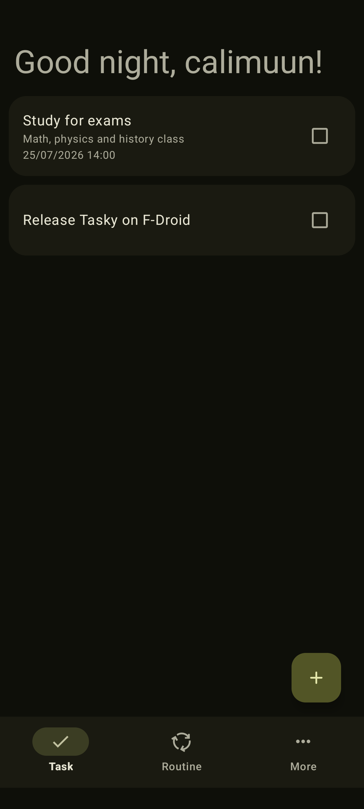
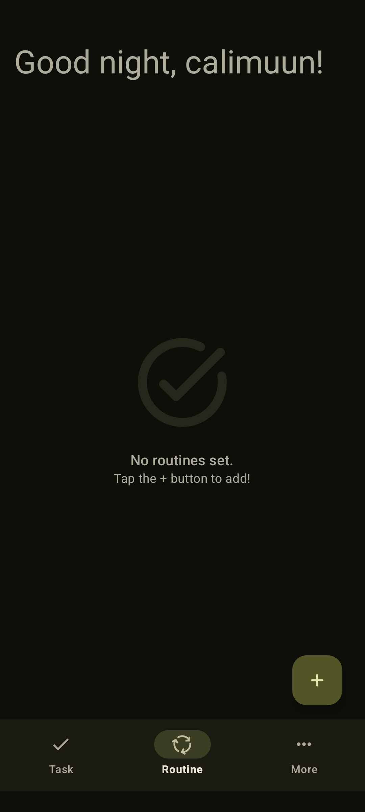
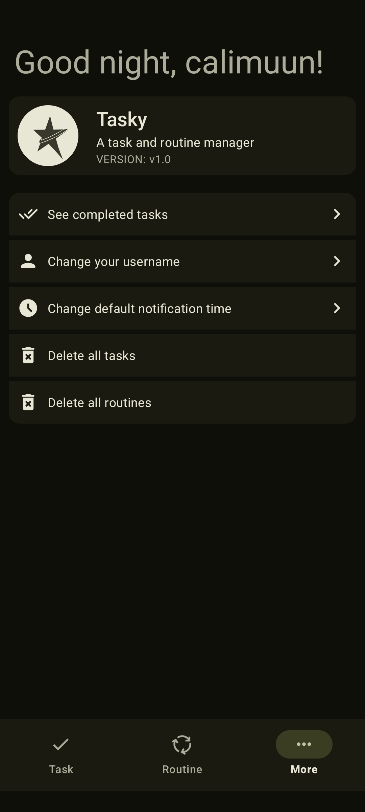

<h1 align="center">Tasky, a task and routine manager</h1>

    Tasky is an app made for my needs. I have no intention of constantly updating it, except for problems that may interfere with use.

<h1>Characteristics</h1>

- Material 3 (Material You) design
- Supports routines (recurrent tasks)
- Notification support for tasks or routines

<h1>Screenshots</h1>

    
    
    

<h1>Custom libs used on Tasky</h1>

- [Konfetti](https://github.com/DanielMartinus/Konfetti)